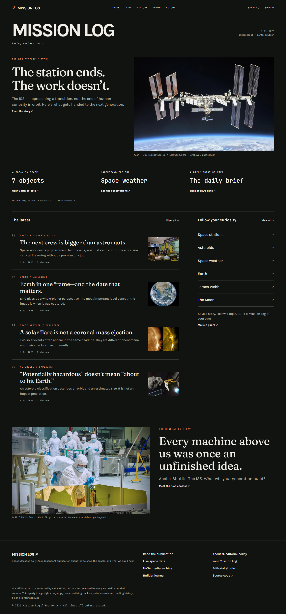

# Mission Log

I made Mission Log as a space blog where the stories sit next to the NASA data they talk about. You can read explainers, browse the data pages, search NASA's media archive, and save things you want to come back to.

[Open the site](https://mission-log-omega.vercel.app/)

## What's in it

- Space articles and topic pages.
- NASA's daily picture, near-Earth object approaches, EPIC images of Earth, and the NASA media archive. The space-weather page uses DONKI; if NASA's feed is unavailable, the page says so.
- Reader accounts with saved stories and images, topic follows, asteroid watchlists, and collections. Collections are private unless you share them, and reading history is off until you enable it.
- An editorial studio for Markdown drafts, source links, image credits, review, and publishing.

The data pages link to their sources and show timestamps. NASA feeds can be delayed, so treat them as observations rather than alerts or forecasts.

## Built with

Next.js 16, React 19, TypeScript, Tailwind CSS 4, Better Auth, MongoDB, and Mongoose. The project uses Node 24; Next.js needs Node 20.9 or newer.

## Run it on your computer

~~~sh
git clone https://github.com/Hustlenix/mission-log.git
cd mission-log
npm ci
~~~

Copy .env.example to .env.local (in PowerShell, run Copy-Item .env.example .env.local) and add your own values:

| Variable | Used for |
| --- | --- |
| MONGO_URI | MongoDB connection string, including the database name |
| BETTER_AUTH_URL | http://localhost:3000 locally; your real site URL in production |
| BETTER_AUTH_SECRET | A long, random secret |
| NASA_API_KEY | A server-side key from [NASA](https://api.nasa.gov/) |
| AUTHORIZED_AUTHOR_EMAILS | Email addresses allowed to receive editorial access |

Don't commit .env.local.

~~~sh
npm run dev
~~~

Create an account at /signup. Signup gives you a reader account. To promote an existing allowlisted account, put its address in a private .env.author.local file as AUTHOR_EMAIL, then run:

~~~sh
node --env-file=.env.local --env-file=.env.author.local scripts/provision-owner.cjs --grant-admin
~~~

This only changes that account's role; it doesn't create an account or verify an email.

The repo also has five starter explainers. If you want to import any that aren't already in your database, run:

~~~sh
node --env-file=.env.local scripts/import-publication.cjs
~~~

It skips existing slugs and doesn't overwrite articles. Use it only with the database you mean to update.

## Checks

~~~sh
npm test
npm run test:security
npm run security
npm run security:history
npm run lint
npm run build
~~~

The browser check lives at scripts/verify-publication.cjs. It can create temporary test accounts and content, so use a test database, not production.

The security check doesn't print secret values. The history check may flag an old credential even after rotation; see docs/security-recovery.md.

## A few things to know

NASA data is cached in MongoDB, so a page may show an older observation during an outage. Email verification and password-reset email aren't set up yet. There are no public comments, newsletter, or push alerts.

Some code, documentation, and the starter explainers were made with AI assistance. The explainers are source-guided starting points, not original reporting, and still need editorial review.

Mission Log is an independent project and isn't affiliated with or endorsed by NASA. Images and data link back to their sources; third-party image rights may apply.
